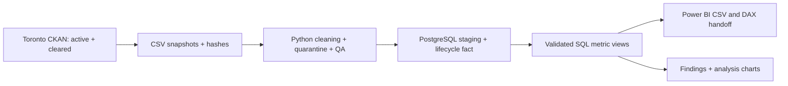
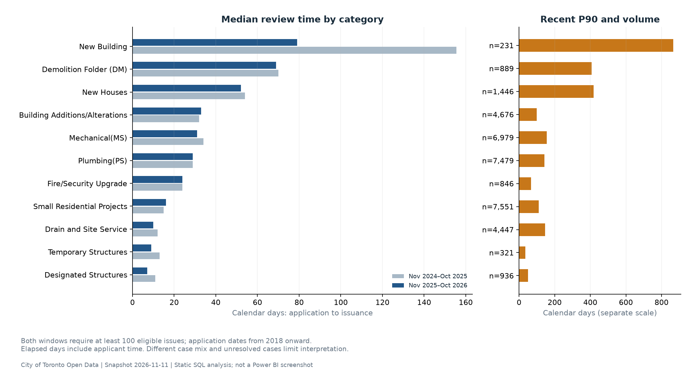

# PermitOps — Toronto permit operations analytics

An analyst portfolio MVP using real City of Toronto permit records to identify categories for operational investigation. Python cleans and audits the data, PostgreSQL computes reusable metrics, and CSV datasets plus DAX measures support a three-page Power BI report.



[Build status and tested commands](docs/BUILD_STATUS.md) lists what works and what remains unfinished.



Static analysis of two complete issue-year windows; this is not a Power BI screenshot. [Monthly volumes](docs/figures/monthly_volumes.png) and [active workload](docs/figures/active_workload.png) show the other core questions. All charts include cohort definitions and source attribution.

The stakeholder is hypothetical. Findings describe recorded elapsed time, not proven causes, staff performance, or achieved improvements. See [findings](docs/findings_recommendations.md), [KPI definitions](docs/kpi_definitions.md) and [quality report](docs/data_quality_report.md).

## Run locally

Requirements: Python 3.13, PostgreSQL 15+ binaries, internet access for first download. The commands below create an isolated local development database; use a separately secured database for deployment.

```bash
python3 -m venv .venv
.venv/bin/pip install -r requirements.txt
mkdir -p .local/socket
initdb -D .local/postgres -A trust --no-locale -E UTF8
pg_ctl -D .local/postgres -l .local/postgres.log -o '-p 55432 -h 127.0.0.1' start
.venv/bin/python -m src.pipeline --download --as-of 2026-11-11
.venv/bin/python -m pytest -q
```

Replace the example as-of with the extraction date when downloading fresh data. `PERMITOPS_DSN` may specify an existing PostgreSQL database instead of the default `host=127.0.0.1 port=55432 dbname=postgres`. The pipeline replaces tables only within its dedicated `permitops` schema. Do not rerun initdb against an existing cluster. The session's server uses port 55432 and `.local/socket`; reuse it while running.

With retained raw files and manifest, rerun without downloading:

```bash
.venv/bin/python -m src.pipeline --as-of 2026-11-11
psql -h 127.0.0.1 -p 55432 -d postgres -f sql/04_analysis.sql
psql -h 127.0.0.1 -p 55432 -d postgres -f sql/05_validate.sql
pg_ctl -D .local/postgres stop
```

On this Mac binaries are at `/opt/homebrew/opt/postgresql@15/bin/`. In the coding sandbox, public network downloads, PostgreSQL initialization/start and database connections required execution approval. A local terminal outside that sandbox may not have those restrictions.

An additional SQL regression test runs against a separate database named `permitops_test` when `PERMITOPS_TEST_DSN` is set. It uses explicit synthetic fixtures with known percentile answers, never the portfolio findings data. The default test command skips that test unless configured:

```bash
createdb -h 127.0.0.1 -p 55432 permitops_test
PERMITOPS_TEST_DSN='host=127.0.0.1 port=55432 dbname=permitops_test' .venv/bin/python -m pytest -q
```

## Outputs and evidence

- `src/`: download, cleaning, database load, validation and findings generation.
- `sql/`: schema, dimensions, reporting views and analysis examples.
- `data/raw/manifest.json`: exact downloaded source fingerprints.
- `data/clean/`: local staging, quarantine, removed duplicates and lifecycle fact CSVs.
- `outputs/data_quality.json`, `outputs/validation.json`: machine-readable counts and independent SQL checks.
- `outputs/reporting/`: SQL export datasets, including record-level `fact_reporting.csv` for interactive Power BI percentiles.
- [Power BI build specification](dashboard/README.md) and [DAX measures](dashboard/measures.dax): provided, not executed in Power BI.
- [Learn after the build](docs/LEARN_AFTER_BUILD.md) and [decisions/debug journal](PermitOps_Decisions_Learning_and_Debug_Log.md).
- `docs/figures/`: reproducible PNG/SVG analysis charts and input provenance. Regenerate with `.venv/bin/python -m src.charts` after a validated pipeline run.
- `dist/PermitOps_PowerBI_Handoff.zip`: local Windows-transfer bundle containing actual reporting CSVs, typed Power Query templates, DAX, model instructions and definitions. Generate it with `.venv/bin/python -m src.package_handoff`; its integrity/hash evidence is in `outputs/handoff_package.json`. The archive stays outside Git because it includes the large record-level reporting dataset.

Power BI Desktop is unavailable in this macOS environment. No PBIX, dashboard screenshots, Power BI validation or public GitHub publication is claimed. The report import/model/measures are a handoff for a Windows Power BI session.

## Scope and cautions

Historical metrics use applications from 2018 onward and issue dates before the extraction month; current workload includes older active applications. Numeric revisions are normalized and counted separately. Conflicting permit/revision keys are quarantined. Terminal cancellations and non-permit administrative categories are explicitly excluded from KPI populations. No large valid duration is silently trimmed. See the KPI contract for precise denominators.

Contains information licensed under the [Open Government Licence – Toronto](https://open.toronto.ca/open-data-licence/), from the City's [active](https://open.toronto.ca/dataset/building-permits-active-permits/) and [cleared](https://open.toronto.ca/dataset/building-permits-cleared-permits/) permit resources. No City endorsement is implied.
