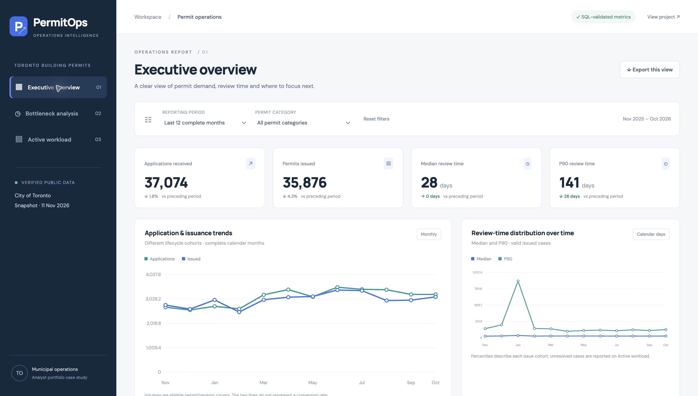
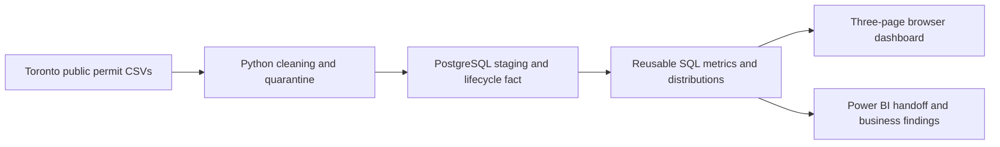

# PermitOps | Toronto permit operations intelligence

**Which permit categories should an operations manager investigate first?**

[Open the live manager dashboard](https://permitops-operations.smalliris16.chatgpt.site) · [Executive brief](docs/EXECUTIVE_SUMMARY.md) · [New Houses deep dive](docs/NEW_HOUSES_DEEP_DIVE.md)

PermitOps turns Toronto building-permit records into a practical view of demand, elapsed review time and unresolved workload. It is a portfolio case study for a hypothetical municipal operations manager, using real public data and explicit quality controls.

## The business problem

An open permit count alone cannot tell a manager whether cases are awaiting review or already in construction and inspection. Category averages can also hide a small but consequential long-duration tail. The decision is where to investigate, with enough evidence to distinguish severity, scale and changing case mix.

## Data and tools

**649,376 source records** from the City of Toronto: 197,258 active and 452,118 cleared. Snapshot: **November 11, 2026**. Python/pandas cleans and validates the data; PostgreSQL defines reusable analytics; an interactive JavaScript/SVG dashboard makes the results accessible on a Mac or browser.

The default dashboard window is **November 2025–October 2026**: **35,876 eligible issued records**, **28-day median** and **141-day P90**. Historical review metrics include applications from 2018 onward and exclude the incomplete extract month. Active workload uses all application years. Each analytical record is a permit/revision identifier, not a building project.

## Three findings a manager can act on

| Finding | Evidence | Recommended investigation |
|---|---|---|
| New Building has a long review-time tail despite a lower median | 231 recent issues; median 79 days; P90 866 days; prior median 155.5 days | Audit long cases for complexity, completeness and response cycles before attributing delay |
| New Houses warrants an original-permit deep dive | 1,446 recent issues; 52-day median; 419.5-day P90. Original permits are 53.0% of issues but 86.8% of reviews over a year | Sample original cases and investigate the Q1 2026 issuance concentration; compare within-group rates and case histories |
| Active workload is much larger than the unissued queue | 194,325 active records; 13,580 unissued (7.0%) | Separate review queues from construction/inspection activity, and validate very old open statuses |

These are observed elapsed-time patterns, not proven causes, legal SLAs or measured staff performance. No operational improvement is claimed. Read the [executive brief](docs/EXECUTIVE_SUMMARY.md) for actions and the [deep dive](docs/NEW_HOUSES_DEEP_DIVE.md) for denominators, revision comparisons and quarter coverage.

## The manager dashboard

The completed web application runs on macOS and in modern browsers, without Power BI Desktop. It is an interactive **data snapshot**, not a live City feed.

1. **Executive overview:** application/issue counts, median/P90, complete-month trends and an investigation shortlist.
2. **Bottleneck analysis:** category duration/volume comparisons, equal prior periods and a fixed-cohort New Houses revision spotlight.
3. **Active workload:** active versus unissued counts, age buckets and the oldest unresolved categories.

Date/category filters recompute exact percentiles from record-frequency distributions. The workload page keeps its snapshot scope. Tables support category drill-down; export downloads the current view. Definitions and quality caveats are available in the report.

[Open the public dashboard →](https://permitops-operations.smalliris16.chatgpt.site)

**Current visual design:** version 2 uses an editorial black masthead, custom PermitOps monogram, architectural line art, cobalt highlights and a warm paper canvas. Open the live dashboard above to see the current style.

Earlier version 1 Chrome captures: [Bottleneck analysis](dashboard/screenshots/02-bottleneck-analysis.png) · [Active workload](dashboard/screenshots/03-active-workload.png). These genuine captures show the earlier layout; version 2 is live at the dashboard link. Separate [SQL analysis figures](docs/figures/category_review_times.png) remain available.

[Watch the three-minute manager tour](dashboard/recordings/PermitOps_3_Minute_Manager_Tour.mp4) · [Narration and interview practice script](docs/WALKTHROUGH_3_MINUTES.md). The video uses version 1 dashboard captures with computer-generated narration; it is a screenshot-based tour, not the project owner's recorded voice or a continuous screen recording.

## Trust and analytical limits

- 10,730 conflicting-key rows are quarantined; 25 analytically redundant rows are removed. No conflicting row is selected arbitrarily.
- Invalid chronology is flagged, while large valid durations remain. Terminal/administrative exclusions are explicit.
- Issuance cohorts omit unresolved cases from final review durations; active unissued age provides the complementary view.
- Revisions are counted separately. Original-versus-revision and period comparisons are descriptive, without case-complexity adjustment.
- The public dashboard contains aggregate distributions only: no individual permit IDs, street addresses, descriptions or builder names.

Evidence: [KPI definitions](docs/kpi_definitions.md), [quality report](docs/data_quality_report.md), [validation results](outputs/validation.json), [dashboard SQL references](outputs/dashboard_sql_reference.json), and [New Houses group checks](outputs/new_houses_deep_dive.json).

## Technical implementation

The core pipeline has 41 SQL/pandas checks and six Python/PostgreSQL tests. The dashboard has 16 calculation/interface tests, including independent SQL reference values; the New Houses analysis adds 15 SQL/pandas group checks. See the [technical guide](docs/TECHNICAL_GUIDE.md) for setup and database commands, [dashboard guide](web-dashboard/README.md) for the Mac workflow, and [Learn After Build](docs/LEARN_AFTER_BUILD.md) for architecture and interview preparation.

Power BI CSVs, M templates and DAX remain available as a separate Windows handoff. No PBIX or Power BI runtime validation is claimed; the published dashboard is a working web application.

## Source and licence

City of Toronto [active permits](https://open.toronto.ca/dataset/building-permits-active-permits/) and [cleared permits](https://open.toronto.ca/dataset/building-permits-cleared-permits/). Contains information licensed under the [Open Government Licence – Toronto](https://open.toronto.ca/open-data-licence/). This independent project is not endorsed by the City.
